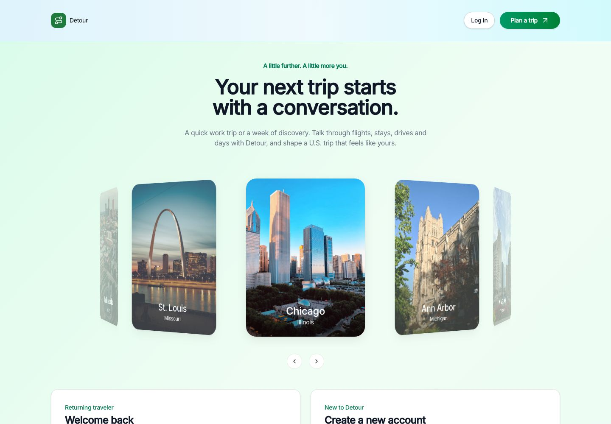
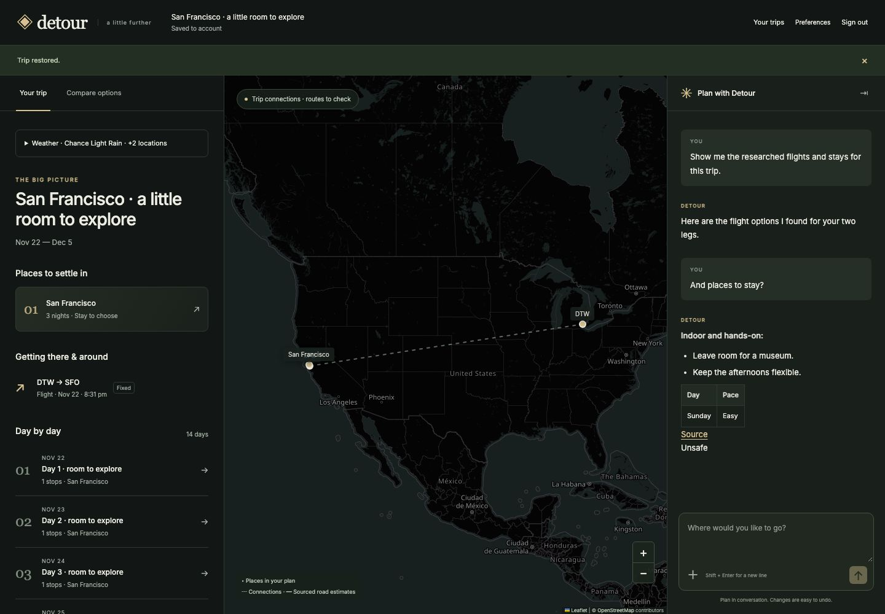

# Detour

A conversational U.S. trip planner built in Jac. Start at the familiar Detour landing page, then talk through a professional trip or multi-day vacation in the linked map, itinerary and chat workspace. Routine requested edits apply immediately with Undo; consequential changes proposed by the assistant are confirmed in plain chat.

**Local trip-guide follow-up — November 16:** The current branch adds a useful all-days saved guide, selected travel/stay summaries, contextual comparisons, real place photos, sourced flight segments and whole-trip PDF download beside compact chat. This iteration is local-only; it has not been committed, pushed or deployed. Validation is complete: 75 Jac source checks, 134 Jac tests, 141 final Node checks and 203 Python tests passed, along with the final sealed build, 31/31 browser checks and 18/18 cold-offline PDF checks. Public-only model flight and real offsite source checks also passed. The public link below still refers to the earlier production release. See [trip-guide design and validation status](docs/trip-guide.md) and [the prior workspace refresh](docs/studio-ux-refresh.md).

**Open Detour: [https://activity-fed-fame-sense.trycloudflare.com/](https://activity-fed-fame-sense.trycloudflare.com/)** · [Trip studio](https://activity-fed-fame-sense.trycloudflare.com/studio)

This free public deployment runs on the existing Mac through a temporary Cloudflare Quick Tunnel. The Mac, app and tunnel must remain running; the hostname changes if the tunnel is recreated. Setup, persistence and hosting limits are documented in [the deployment guide](deploy/README.md).

See [current implementation and verification](docs/trip-planner-implementation-status.md#current-detour-implementation) and [the Detour product contract](docs/DETOUR-AGENT-HANDOFF.md). Older Atlas, universal-approval, all-in-total-only and studio-as-home descriptions are historical where they conflict with the current contract.

## Run locally

Use the pinned **Jac 0.37.14**, **Python 3.13** and **Node 22.11.0**. Install Jac following [the web setup](web/README.md#toolchain-and-first-setup), then from this directory:

```sh
cd web
../scripts/jac install
cd ..
python3.13 -m venv workers/.venv
workers/.venv/bin/python -m pip install -r workers/requirements.lock
PLAYWRIGHT_BROWSERS_PATH="$PWD/workers/.browsers" workers/.venv/bin/python -m playwright install chromium
cp workers/.env.example workers/.env
# Configure ANTHROPIC_API_KEY in workers/.env, then:
bash scripts/dev-studio.sh
```

Open [Detour](http://localhost:8000/); Plan a trip opens [the studio](http://localhost:8000/studio). The supervisor starts Jac and its separate planning worker with the same private configuration. Keep credentials in `workers/.env`, outside Jac's packaged `web/` directory. See [runtime setup and deployment boundaries](workers/README.md).

## The experience

- Start as a guest, then save to an account and resume across devices. The recognizable landing page is `/`; the conversational workspace is `/studio`.
- Plan logistics-only business trips or detailed vacations with mixed flights and driving. Every saved day remains navigable beside compact chat, with visual itinerary cards and selected travel/stay summaries. Your trip and Map preserve day/view context when reopening.
- Discuss selected places and activities in the main chat. Routine edits apply with Undo; consequential assistant suggestions ask a plain-language question bound to the current trip. Booked/fixed commitments stay protected.
- Paste a plan or upload text, PDFs and images. Review or forget learned preferences. Delete trips with Undo or restore them from Recently Deleted for 30 days; abandoned near-empty shells are cleaned after 24 hours while meaningful plans and retained drafts are protected.
- Open contextual comparisons from the flight, stay or car you are planning; flight alternatives remain grouped by leg/date/party. Choose uses the existing agent pipeline and preserves unsent work. Saved choices show their available price basis and actual booking status; selection remains distinct from booking.
- Follow one persistent line showing actual work. Compact weather tiles show conditions, temperature, precipitation and wind; official warnings remain available on demand, and distant trips use quiet forecast-availability states.
- Read the last saved itinerary and booking details offline after loading the app online. Export PDF downloads the entire saved guide, including all days and available journey diagrams, from the browser; maps, new photos and research require a connection.



Earlier published workspace; the local refresh is described in [the design note](docs/studio-ux-refresh.md).



## What is verified

The latest saved-guide/photo/flight-segment/PDF follow-up is complete: 75 Jac source checks, 134 Jac tests, 110 client + 31 PDF Node checks (141 total), 203 Python tests, final sealed build, 31/31 browser and 18/18 cold-offline PDF checks passed; [its validation status](docs/trip-guide.md#validation-status) is the source of truth. The results below are earlier implementation evidence, not final acceptance of the follow-up.

The prior local compact-workspace pass completed **74 Jac source checks, 134 Jac tests, 106 Node tests and 181 Python tests**, the sealed build, 27/27 layout checks and 6/6 handoff/mobile checks. Actual model-backed Choose → Undo passed 15/15 checks using unchanged genuine historical quotes. The separate fresh search found no qualifying offers. See [the refresh validation](docs/studio-ux-refresh.md#validation-status) for the exact evidence. The following paragraphs describe the earlier published release, not a deployment of this local refresh.

Current browser QA passed **28/28 checks with zero page errors**, including desktop/phone navigation, real Markdown rendering, trip lifecycle and source-card presentation. Live conversational checks exercised an actual rest-break edit and Undo while preserving fixed commitments and unrelated days; separate model-stage checks exercised consequential questions and bound confirmation. A real NWS adapter check returned a forecast and an official warning.

The exact live research scenario produced **six real offers** across DTW → SFO on November 22, SFO → XNA on November 25, and a San Francisco hotel November 22–25, 2026 for one adult/one room. A fresh guest conversation then completed the actual app → queue → worker → staging → chat journey with **nine real cards**, three per component, unchanged itinerary and zero errors. Separate Airbnb research produced **three real dated home/room offers**. The actual car-chat pipeline also passed with **three genuine dated car cards**, using an observed provider-results URL as its research lead and preserving the itinerary. These are observed source results, not guaranteed future inventory or booked travel. See [evidence and material limits](docs/trip-planner-implementation-status.md#current-detour-implementation).

Merged-main validation passed **74 Jac source checks, 134 Jac tests and 81 Node tests**; the final Python suite passed **167 tests**, including production supervision, stable release materialization and sealed-manifest integrity regressions. The real Chromium control regression, sealed release build, offline finalization and secret scan also passed. The public HTTPS chat → queue → Anthropic → staged reply journey passed, as did native production ownership/revision checks and account/session/trip persistence across artifact upgrades and restart. See [release and deployment evidence](docs/trip-planner-implementation-status.md#release-and-deployment-status).

## Validate and preview

```sh
JAC_BIN="$PWD/scripts/jac" bash scripts/validate.sh
workers/.venv/bin/python scripts/test-studio-api.py  # local Jac server running
workers/.venv/bin/python scripts/preview-studio.py  # built production client on :8002
```

Validation checks every Jac source, runs Jac tests, builds the client and Jac artifact, installs the studio's offline service worker in both outputs, scans for packaged secrets, and runs client/worker regressions. The deterministic suites require no API key or public-site access. The local Chromium interaction regression uses the browser installed during setup above. [Live test commands](workers/README.md#live-verification) deliberately use model credits and public sites.

The runtime requires one supervised Jac server/worker host, a persistent Jac PostgreSQL store and private worker volume. [Production setup](deploy/README.md) serves the sealed release on port 8080 with a stable private application/data path and optional free HTTPS tunnel. A static client host alone does not provide planning or account persistence. See [release and deployment status](docs/trip-planner-implementation-status.md#release-and-deployment-status) for the current publishing/hosting result and the [worker deployment boundary](workers/README.md#resource-and-deployment-boundary) for required resources.

## Design and source

The current [Detour handoff](docs/DETOUR-AGENT-HANDOFF.md) supersedes conflicting historical product rules. The earlier [adopted decisions](docs/trip-planner-decisions.md), [interaction blueprint](docs/trip-planner-ux-blueprint.md), [architecture](docs/trip-planner-design.md) and [implementation plan](docs/trip-planner-implementation-plan.md) describe the product. Core code lives in `web/components/TripStudio.jac`, `web/server/planning.jac`, `web/server/planning_core.py`, and `workers/atlas_runtime/`.

The earlier commuter preview remains at `/commuter`, `/plan` and `/trips`; the earlier Atlas journal remains at `/atlas`. Their fixture and browser-local contracts are separate from the new studio. Historical documentation is retained in [the previous README](docs/commuter-readme-legacy.md) and [historical web reference](web/README-legacy.md).

Developed for EECS 449 at the University of Michigan.
