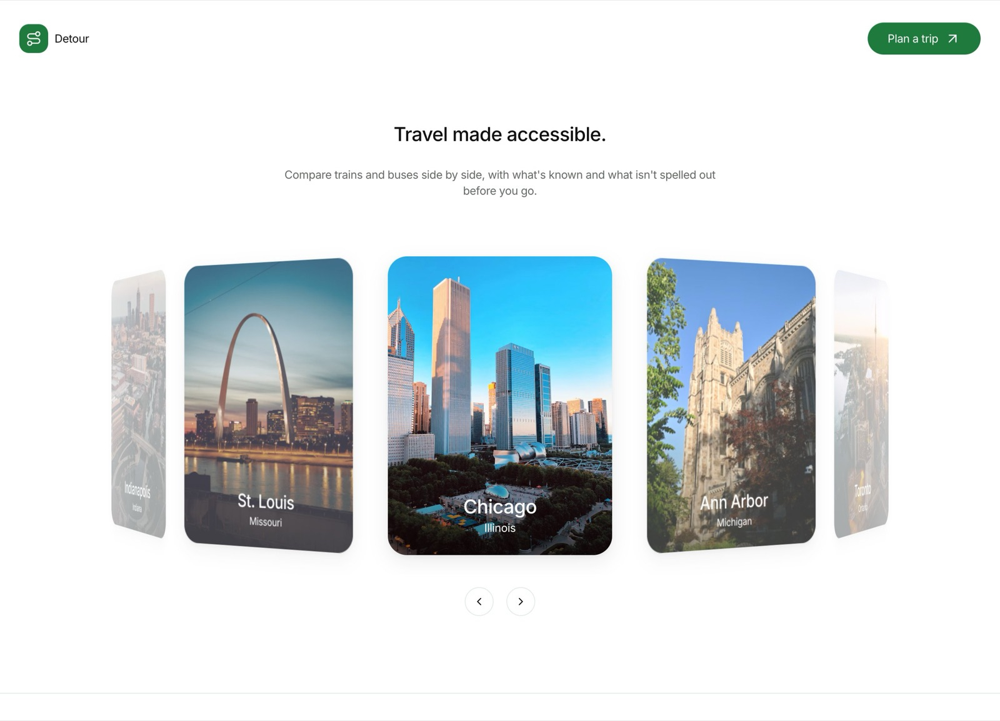
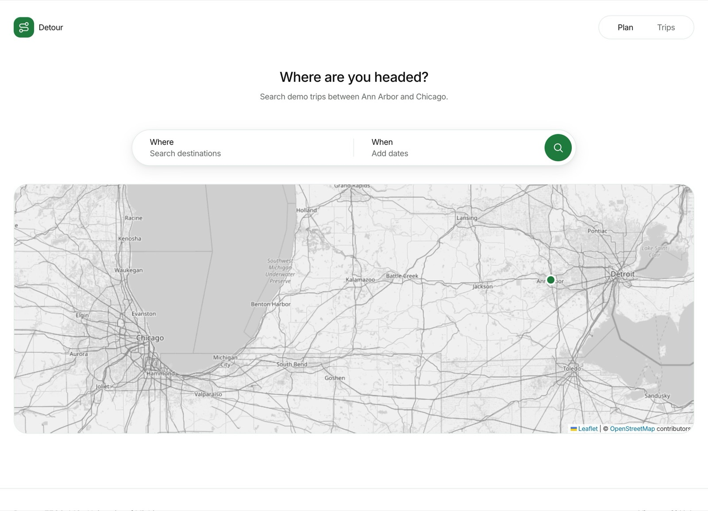
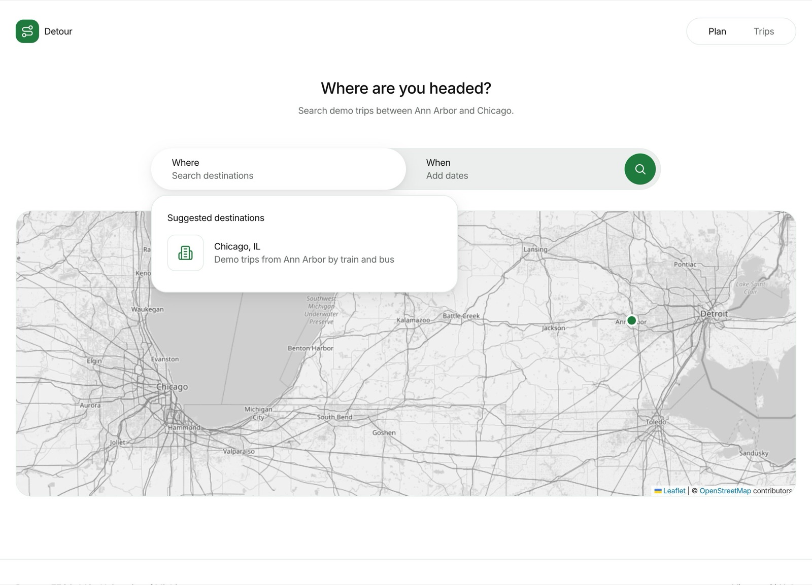
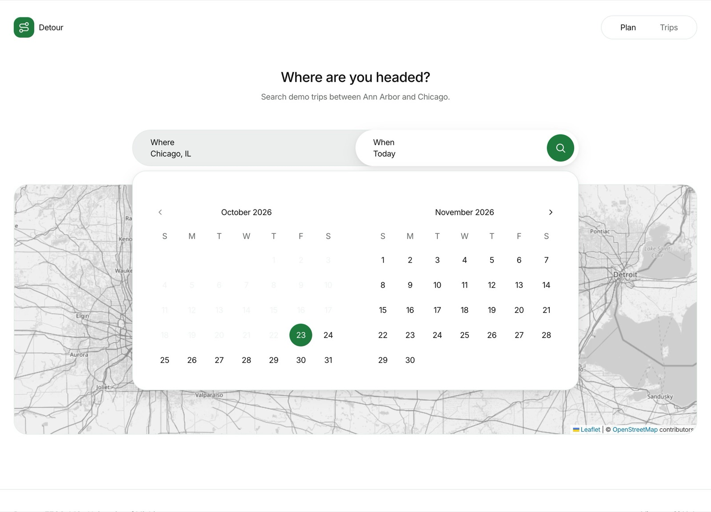
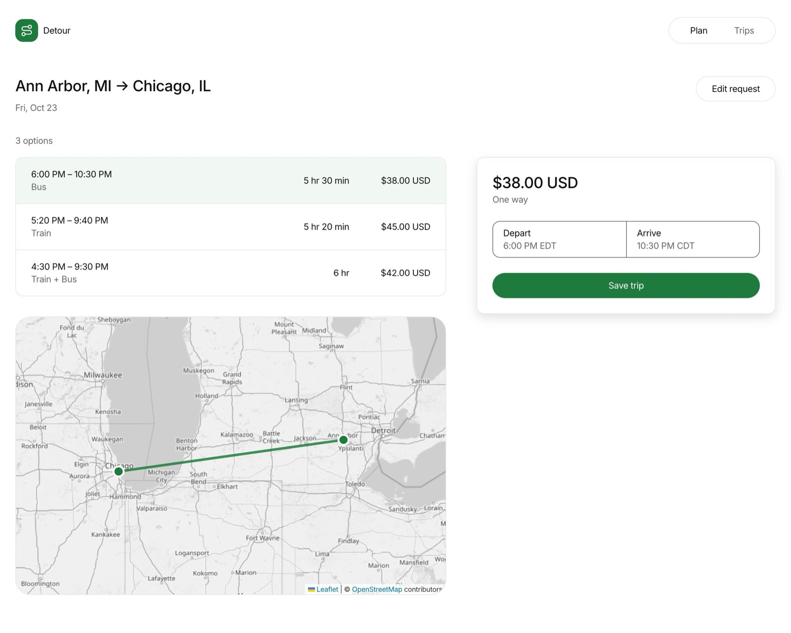
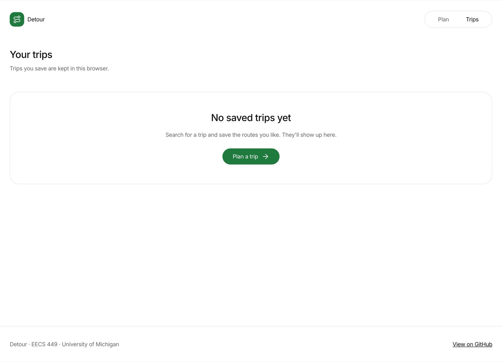
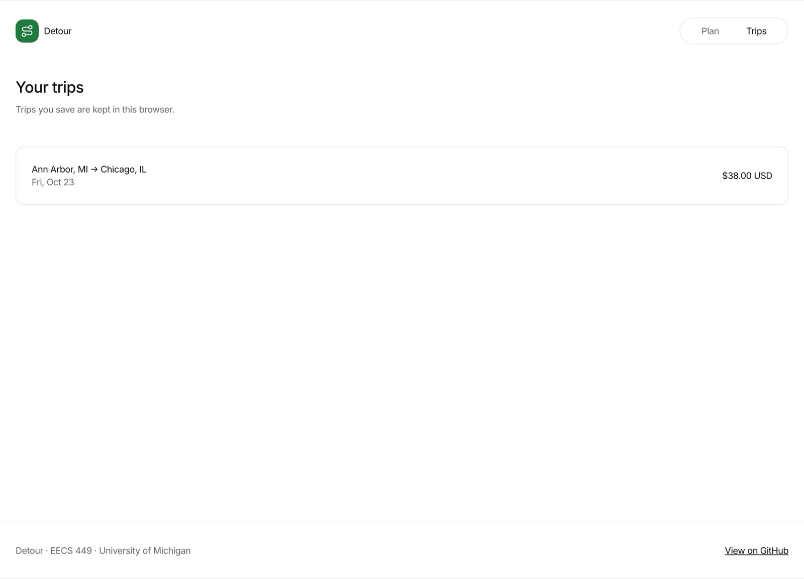
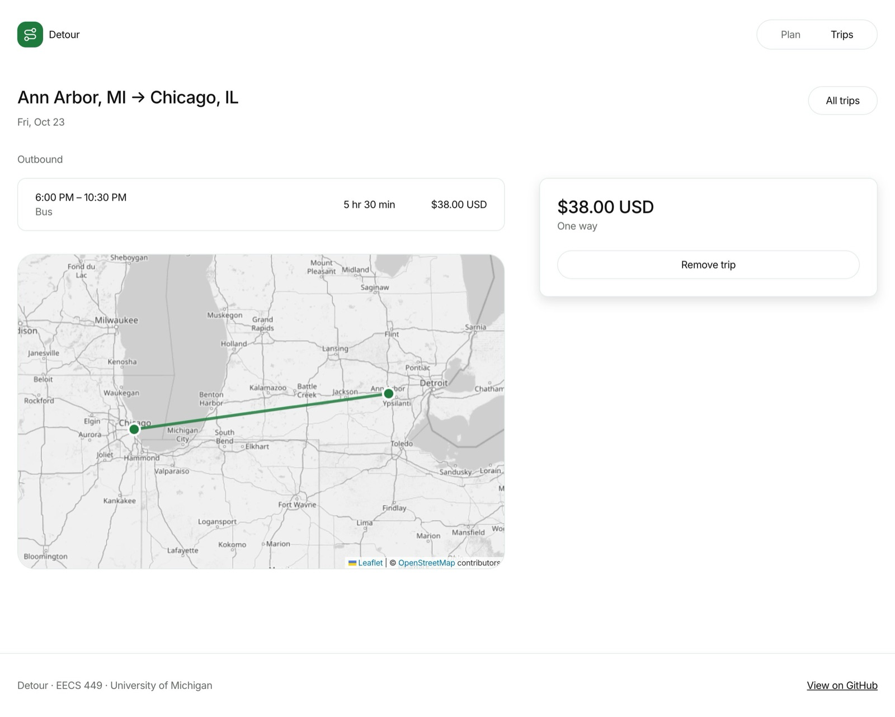
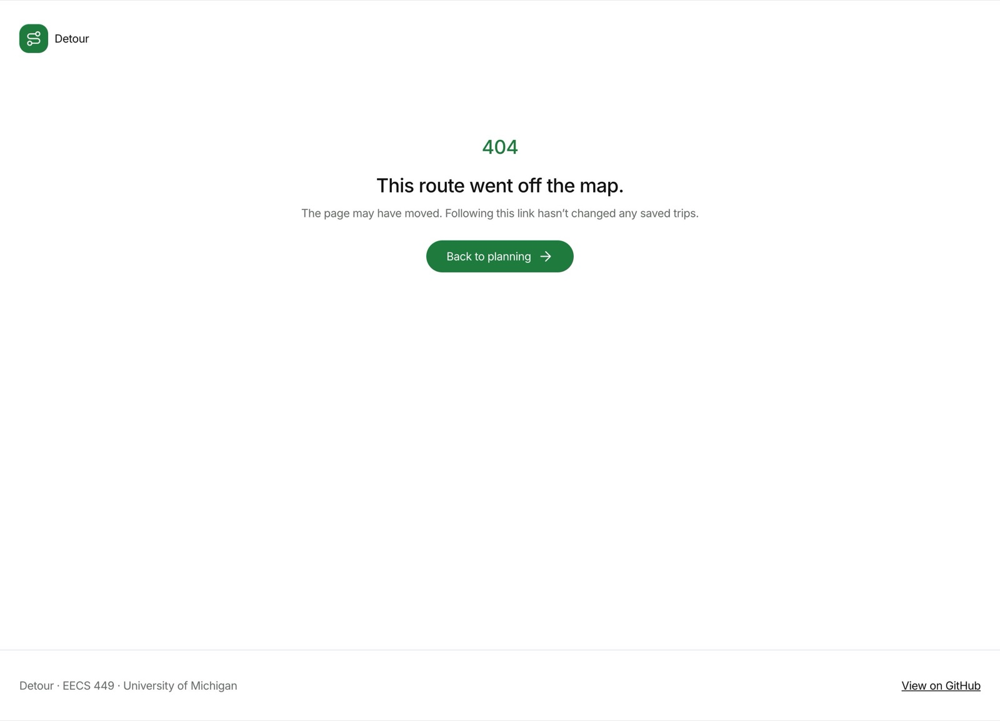

# Detour: an AI copilot for ground commuting

> **Working product name.** Detour is the current design direction for the
> EECS 449 team project; the name can change without changing the product
> contract below.

For a lot of cross-state commuters, there are a lot of tasks that go into making sure they reach their destinations: buying tickets, sorting through confirmation emails, scheduling around conflicts and delays, keeping track of tickets, checking the weather. None of them are hard. Together they take up a lot of time and attention.

This project builds a conversational AI agent that takes over some of that
work. A commuter describes the trip they need in plain language, compares a
small set of feasible routes, sees weather and disruption risks, and confirms
one plan. Detour keeps the confirmed plan in one place without booking or
changing anything behind the user's back.

## Product design

The first implementation target is one narrow, complete path:

**Describe a trip -> compare options -> understand the recommendation ->
confirm -> view the saved trip.**

The complete behavior, component boundaries, data contracts, external API
choices, ranking algorithm, failure states, and architectural decisions are in
the [design plan](docs/design/README.md). The interactive reference can be
opened locally from [`docs/design/prototype.html`](docs/design/prototype.html).

### Screenshots

The current app, captured from the running build at 1248px wide. The original
design targets these were built from are in
[`docs/design/screens/`](docs/design/screens/).

#### 1. Home

A carousel of destinations turning on a cylinder; the header's Plan a trip
button leads into planning.



#### 2. Plan a trip

One search bar for where and when, over a map of the demo corridor.



#### 3. Choose a destination

Where suggests the places the demo can plan, and choosing one moves on to When.



#### 4. Pick dates

When opens a two-month calendar; a second date adds a return trip.



#### 5. Compare routes

Each option shows its times, mode, travel time and fare; the map traces the
selected route and the booking card saves it.



#### 6. Trips, before saving



#### 7. Saved trips



#### 8. Trip detail

The saved route, its map and a way to remove it.



#### 9. Not found



## Product principles

1. **Conversation for intent, code for decisions.** The LLM converts plain
   language into a typed trip request. Deterministic code validates, scores,
   and ranks routes so recommendations are reproducible.
2. **Make tradeoffs legible.** Every recommendation identifies the concrete
   reasons it won: time, cost, transfers, reliability, and weather exposure.
3. **Keep the user in control.** Nothing is booked, messaged, or added to an
   external service without an explicit confirmation.
4. **Design for incomplete data.** Missing real-time data means “unknown,” not
   “on time.” The interface exposes freshness and confidence.
5. **Ship a complete vertical slice first.** The MVP uses deterministic route
   fixtures where necessary, then swaps in live providers behind stable
   interfaces.

## MVP use case

A student asks: “Get me from Ann Arbor to Chicago Friday after 4 PM. Keep it
under $50 and avoid tight transfers.” Detour returns up to three ground-transit
options, incorporates forecast and disruption information, explains its
recommendation, and saves the selected plan after confirmation.

The MVP does **not** purchase tickets, connect email or calendars, continuously
monitor trips, or promise nationwide coverage. Those are later capabilities
once the planning loop is reliable.

## Status

The repository implements a read-only, fixture-backed planning preview:
accessible structured input, a validated server endpoint, three synthetic
Ann Arbor–Chicago routes, deterministic feasibility/scoring, and selectable
route comparisons with explicit provenance and unknown conditions. See the
[preview contract and limitations](docs/planning-preview.md),
[domain contracts](docs/domain-model.md), [fixture adapter](docs/fixture-provider.md),
and [scoring rules](docs/scoring.md).

Plain-language requests ("Chicago Friday after 4, under $50") are read by
Claude (one direct API call) when `ANTHROPIC_API_KEY` is set, and by a rule-based
parser otherwise (`web/server/interpret.jac`); either way they only fill the
search form, which the planner validates. Saved trips are kept in the
browser's local storage for now. Authentication, server-side saved trips, and
live weather/transit integrations remain planned work. See the
[architecture decisions](docs/design/ARCHITECTURE_DECISIONS.md) for the system
boundaries, algorithms, API choices, data lifecycle, and design tradeoffs.

## Development

Use **Jac 0.37.14** (standalone compiler); the JavaScript tooling baseline is
**Node 22.11.0** in `.nvmrc`. Follow [web setup](web/README.md) to install and
run the application. From the repository root, run the same checks as CI:

```bash
bash scripts/validate.sh
```

This checks every Jac source, runs all Jac regression suites, builds the full
application from current sources, and tests the emitted comparison adapter.

### Deploying

[`render.yaml`](render.yaml) describes a Render web service:
`scripts/render-build.sh` installs the pinned Jac compiler inside the checkout
and builds the app, and `scripts/render-start.sh` serves it on Render's
`$PORT`. Set `ANTHROPIC_API_KEY` in the service's environment to have Claude
read requests; without it the built-in parser answers. The free plan sleeps
after 15 idle minutes and takes about a minute to wake.

## Course

This project is being developed for EECS 449 (Conversational AI) at the University of Michigan.
