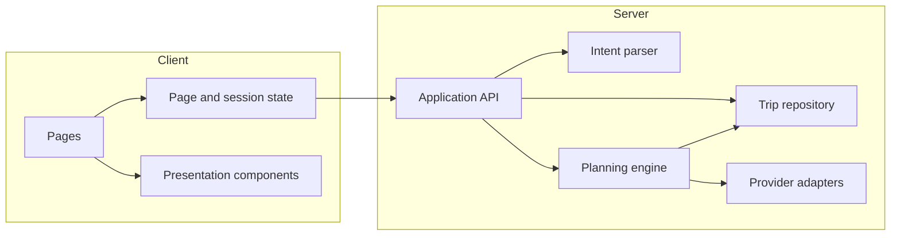
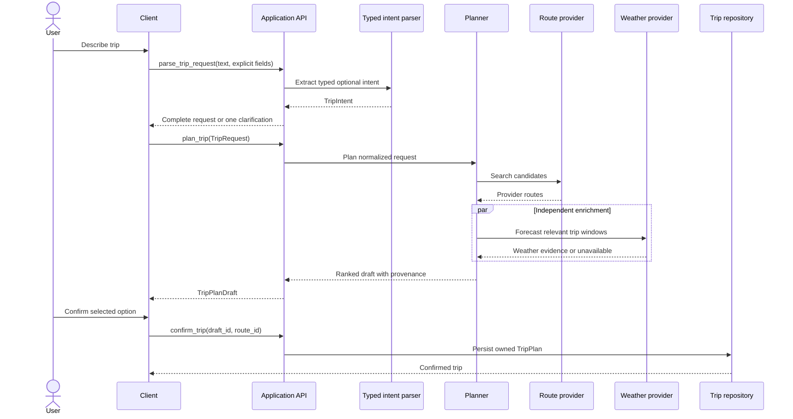
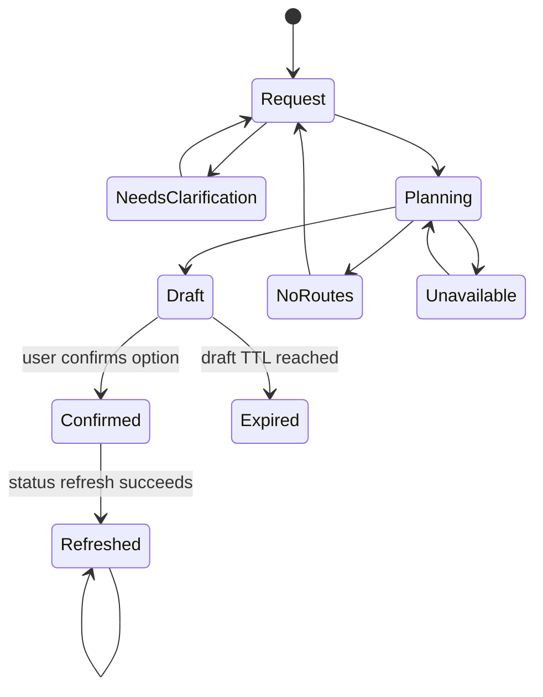

# Architecture and design decisions

This document records the decisions that define Detour independently of how
the work is divided or scheduled. An implementation may change file names or
internal syntax, but it should preserve these boundaries unless the team
updates this document with a new decision and rationale.

## Decision summary

| Area | Decision | Why |
| --- | --- | --- |
| Product boundary | Plan and save trips; do not purchase, message, or rebook | Delivers the core value without unsafe or irreversible actions |
| Runtime shape | One modular Jac application | Fastest path to a coherent MVP without distributed-system overhead |
| LLM responsibility | Parse intent and optionally phrase grounded explanations | Uses language understanding without trusting a model with facts or decisions |
| Recommendation | Hard constraints followed by deterministic multi-criteria scoring | Reproducible, inspectable, and directly testable |
| Data boundary | Normalize every provider into Detour-owned typed objects | Prevents provider schemas from leaking through the product |
| Route source | Fixture-backed corridor first; live provider behind an adapter | Guarantees a working demo while preserving an upgrade path |
| Weather source | NWS adapter for US forecasts and alerts | Open data with clear provenance and no booking dependency |
| Missing data | Unknown plus an uncertainty penalty, never implicitly safe | Avoids false confidence |
| Persistence | Persist only confirmed plans and preferences | Keeps drafts cheap and makes user intent explicit |
| External effects | Separate preview from commit and require confirmation | Preserves user control |
| Failure model | Typed domain errors and partial degradation | Keeps provider failures recoverable and UI behavior predictable |
| Observability | Structured metadata without raw trip text by default | Supports debugging while minimizing sensitive-data collection |

## System boundary

Detour is a modular monolith. The client, server functions, persistence, LLM
parser, planning engine, and provider adapters live in one deployable Jac
application, but communicate through typed boundaries.



Dependency rules:

1. Client code calls only public application functions, never external APIs.
2. Provider adapters depend on external schemas; domain and UI code do not.
3. The planner consumes normalized domain objects and contains no HTTP logic.
4. The LLM parser produces intent fields and cannot call persistence or
   side-effecting tools.
5. Persistence owns authorization and storage mechanics, not route scoring.

This shape was chosen over microservices because the MVP has one team, one user
flow, and low expected load. Separate services would add deployment, tracing,
versioning, and failure modes before the domain boundary is stable. The adapter
and application-service interfaces preserve the option to split later.

## Request lifecycle



Clarification is part of parsing, not an agent loop. Detour asks one concrete
question, merges the answer into known fields, and validates again. This avoids
unbounded conversation state and makes incomplete requests testable.

## ADR-001: use a canonical typed domain model

**Decision:** Provider responses are converted immediately into Detour-owned
types such as `Place`, `RouteOption`, `RouteLeg`, `WeatherEvidence`, and
`ProviderMetadata`.

**Why:** Ranking and UI behavior should not change when a provider renames a
field. A canonical model also allows fixtures, recorded responses, and live
providers to exercise the same code.

**Rejected alternative:** Passing provider JSON directly to components. This
is initially quick but couples pages, scoring, tests, and persistence to one
vendor and makes provenance inconsistent.

**Consequences:** Adapters require explicit mapping and contract tests. A
provider-specific field is omitted unless it has a meaningful canonical home;
raw payloads are not persisted as the product model.

Every provider result uses an envelope:

```text
ProviderResult[T]
  data: T | None
  status: LIVE | CACHED | FIXTURE | UNAVAILABLE
  provider: str
  fetched_at: datetime | None
  expires_at: datetime | None
  warnings: list[ProviderWarning]
```

This makes source mode and freshness impossible for callers to forget.

## ADR-002: constrain the LLM to semantic parsing

**Decision:** A typed byLLM function converts natural language into
`TripIntent`. Explicit form fields override extracted fields. Deterministic
validation produces clarification questions.

**The LLM may:**

- identify origin and destination phrases;
- interpret “Friday after four” as a departure constraint;
- extract price, mode, and transfer preferences;
- optionally rewrite a fact set into concise user-facing prose.

**The LLM may not:**

- invent schedules, fares, weather, delays, or availability;
- decide that a route is feasible;
- compute or override scores;
- save a plan or call an external side-effecting tool.

**Rejected alternative:** A ReAct agent that chooses and calls all providers.
That architecture is flexible, but tool selection, stopping behavior, latency,
and factual grounding become difficult to reproduce. Detour's provider sequence
is known in advance, so ordinary orchestration is clearer.

**Failure policy:** Authentication, rate-limit, timeout, and output-conversion
failures return a typed parser error and reveal the structured fields. The user
can still complete the request without the model.

## ADR-003: use two-stage deterministic recommendation

**Decision:** First apply hard feasibility rules, then score the remaining
routes with a weighted additive utility model.

Hard rules include:

- canceled service;
- departure or arrival outside a strict requested window;
- known price above a strict maximum;
- a transfer shorter than the user's minimum buffer;
- a mode explicitly excluded by the user.

Hard constraints never become soft merely because an otherwise attractive
route would score highly.

For feasible routes, utilities are in `[0, 1]`, where higher is better:

```text
base = duration_weight    * duration_utility
     + reliability_weight * reliability_utility
     + price_weight        * price_utility
     + transfer_weight     * transfer_utility
     + weather_weight      * weather_utility

score = 100 * base - 10 * uncertainty
```

### Weight presets

| Preset | Duration | Reliability | Price | Transfers | Weather |
| --- | ---: | ---: | ---: | ---: | ---: |
| Balanced | 0.30 | 0.25 | 0.20 | 0.15 | 0.10 |
| Fastest | 0.55 | 0.15 | 0.10 | 0.10 | 0.10 |
| Lowest cost | 0.15 | 0.15 | 0.50 | 0.10 | 0.10 |
| Most reliable | 0.15 | 0.45 | 0.10 | 0.20 | 0.10 |
| Fewest transfers | 0.15 | 0.20 | 0.10 | 0.45 | 0.10 |

Duration and price are normalized relative to the current candidate set after
hard filtering. Reliability, transfer, and weather use domain thresholds so a
set of uniformly poor routes cannot make one look absolutely safe.

Stable tie breakers are fewer transfers, earlier arrival, lower known price,
then provider route ID. The effective weights, feature values, and reason codes
are retained with each draft so a ranking can be reproduced.

**Rejected alternatives:**

- **LLM ranking:** difficult to reproduce and may invent tradeoffs.
- **Fastest route only:** ignores the product's reliability and weather hook.
- **Pareto frontier only:** useful for pruning but does not produce the single
  recommendation the interface promises.
- **Opaque learned ranker:** there is no defensible training dataset yet.

The additive model is intentionally simple. It should be replaced only after
user evidence shows a repeatable failure that a more complex model fixes.

## ADR-004: separate evidence, risk, score, and explanation

**Decision:** These are four different representations:

1. **Evidence:** provider facts with source and timestamp.
2. **Risk assessment:** deterministic interpretation of evidence.
3. **Score:** preference-weighted comparison of feasible options.
4. **Explanation:** reason codes rendered into user-facing language.

This prevents generated prose from becoming the source of truth. For example,
a provider delay prediction is evidence; `DELAY_RISK_HIGH` is an assessment;
its reliability penalty affects score; “higher delay risk” is the explanation.

Reason codes are finite and testable, including `FASTEST`, `LOWEST_COST`,
`DIRECT`, `TIGHT_TRANSFER`, `DELAY_RISK`, `WEATHER_RISK`, `WITHIN_BUDGET`, and
`MISSING_REALTIME_DATA`. An optional LLM rewrite receives only these grounded
facts and cannot introduce new claims.

## ADR-005: model missing and stale data explicitly

**Decision:** Missing evidence is `UNKNOWN`, not zero risk and not a provider
failure. It receives a neutral utility plus an uncertainty penalty.

Examples:

- No real-time trip update means real-time status is unknown, not on time.
- No fare means price utility is neutral unless the user set a strict cap; a
  route with unknown price cannot be certified within that cap.
- Weather failure leaves the route visible with weather unknown.
- Stale cached data remains visible with its age and a warning.

This policy trades some recommendation sharpness for honesty. It also lets the
app return useful partial results when one independent provider is down.

## ADR-006: use provider adapters with an honest fixture mode

**Decision:** `RouteProvider`, `WeatherProvider`, and `Geocoder` are server-side
interfaces. Every environment explicitly selects an adapter; the UI always
receives its source mode.

### Route provider

The baseline adapter loads a committed Ann Arbor–Chicago fixture. The first
live candidate is Google Routes in transit mode because it can return complete
itineraries and alternatives. Transitland REST is a potential GTFS metadata and
alert source, not the assumed journey planner.

Fixture results are never labeled live and never silently replace a failed live
request in production. A failed live provider returns `UNAVAILABLE`; demo mode
must be selected deliberately.

### Weather provider

NWS is the US weather adapter. It resolves a coordinate to a forecast grid,
then loads hourly forecast and alert evidence for departure, transfer, and
arrival windows. Grid mappings and forecasts have separate cache lifetimes.

### Geocoder

The deterministic demo uses a local map of supported corridor locations. A
public Nominatim adapter, if enabled, is server-proxied, cached, rate-limited,
identified, and used only for submitted searches rather than autocomplete.

**Rejected alternative:** Calling providers directly from the browser. That
would expose secrets, duplicate normalization logic, weaken caching and rate
limits, and make deterministic tests harder.

## ADR-007: keep drafts ephemeral and confirmations durable

**Decision:** A planning result is an expiring `TripPlanDraft`. A confirmed
selection becomes an owned persistent `TripPlan`.



Recommended lifecycle:

- Drafts expire after 30 minutes and contain the normalized request, candidate
  snapshots, effective weights, and selected default.
- Confirmation accepts both draft ID and route ID, verifies that the route
  belongs to the draft, and is idempotent.
- Confirmed plans store the chosen snapshot, a backup option when available,
  provenance, reasons, and confirmation time.
- Refresh appends or replaces a bounded current-status snapshot; it never
  rewrites the originally confirmed itinerary without an explicit user action.

Only confirmed plans and user preferences require durable persistence. Raw LLM
conversation history and provider payloads do not.

## ADR-008: orchestrate providers concurrently but degrade independently

**Decision:** Operations run according to data dependencies, not through an
agent-selected sequence.

1. Parse and validate the request.
2. Resolve origin and destination.
3. Search routes.
4. In parallel, enrich relevant route points with weather and available
   real-time evidence.
5. Score as soon as all successful enrichments or their timeouts resolve.

Suggested overall planning budget is 12 seconds. Each adapter has a shorter
timeout and returns a typed result. One enrichment timeout must not cancel
successful route search. Request-scoped IDs support cancellation and prevent a
late response from replacing a newer search.

Cache keys use normalized coordinates, time window, modes, and constraints—not
raw prose. Caches store canonical results plus provenance, never client-ready
HTML or generated explanations.

## ADR-009: expose typed failures, not exceptions

**Decision:** Application APIs return stable domain error codes. Provider and
model exception details remain server-side.

| Code | Meaning | Client behavior |
| --- | --- | --- |
| `INVALID_REQUEST` | Contradictory or invalid fields | Preserve input and mark fields |
| `CLARIFICATION_REQUIRED` | Required meaning is missing | Ask one targeted question |
| `NO_ROUTES` | Providers succeeded but none are feasible | Explain eliminated constraints |
| `PROVIDER_UNAVAILABLE` | Required route data could not be loaded | Retry; never show fixtures as live |
| `PARTIAL_DATA` | Optional enrichment failed | Show routes with unknown/stale labels |
| `DRAFT_EXPIRED` | Confirmation references an old draft | Re-run the preserved request |
| `NOT_FOUND` | Missing or unauthorized trip | Render the same not-found result |
| `SAVE_FAILED` | Confirmation could not persist | Keep the selected draft and retry |

Errors are part of the functional state machine. They are not generic toast
messages layered over an undefined page state.

## ADR-010: keep client state local and server state authoritative

**Decision:** Form text, current selection, expanded details, and loading phase
are client state. Drafts, confirmed plans, preferences, ownership, source
status, and canonical timestamps are server state.

The URL identifies durable navigation state:

- `/plan` for request composition;
- `/plan/results?draft=<opaque-id>` for a current draft;
- `/trips/:id` for a confirmed plan.

Do not serialize full route options, provider payloads, or free-text requests
into URLs. Back navigation should recover the last local request during the
session, while a direct link resolves server-authoritative state.

## ADR-011: prioritize comparison over maps

**Decision:** The MVP uses structured route cards and itinerary timelines, not
an interactive map as the primary surface.

The central problem is choosing among ground-transit options under uncertainty;
time, cost, transfers, and evidence are easier to compare in aligned cards. A
map adds SDK cost, accessibility work, and layout pressure without proving the
recommendation. Provider polylines may be stored later, and a map can be added
when spatial detail changes decisions.

## ADR-012: preserve trust through confirmation and provenance

**Decision:** Planning is read-only. Any later external write—calendar event,
message, notification subscription, rebooking, or purchase—must use a separate
preview and confirmation contract.

Each displayed factual claim can be traced to:

- a provider and retrieval timestamp;
- a deterministic derived rule;
- or a user preference.

The interface never presents a fixture as live, a missing update as on time, or
an LLM statement as provider evidence.

## Security, privacy, and ownership decisions

- Provider and model credentials exist only in server configuration.
- Every persistent operation is scoped to the current owner.
- Missing and unauthorized trip IDs return the same public behavior.
- Logs include request ID, operation, latency, provider, status, freshness, and
  typed error code; raw free-text requests are excluded by default.
- Analytics use coarse events and never include complete itinerary text.
- The MVP requests no email, calendar, payment, or location-background scopes.
- Authentication must be chosen before multi-user persistence is enabled; the
  domain model assumes an owner ID even in single-user development.

## Architectural invariants to test

An implementation is conformant only if these remain true:

1. The same canonical inputs and weights produce the same route order.
2. The LLM cannot add provider facts or persist state.
3. Hard constraints are applied before scoring.
4. Every route fact carries provider mode and freshness.
5. Unknown data never becomes a positive safety signal.
6. A weather failure does not erase valid route options.
7. Confirmation is explicit, authorized, and idempotent.
8. Provider-specific schemas stop at adapter boundaries.
9. No secret or raw server exception crosses to the client.
10. Every typed failure maps to a designed recoverable state.

## Open architectural questions

These require evidence or a team choice; they are not silently assumed:

1. Which authentication mechanism supplies the persistent owner identity?
2. Does Google Routes provide adequate Ann Arbor–Chicago coverage and fare data
   within the team's quota and latency budget?
3. Which hosted or local LLM configuration meets cost, latency, and privacy
   requirements for intent parsing?
4. How long should confirmed status snapshots be retained after a trip?
5. At what user scale must public geocoding be replaced with a contracted or
   self-hosted provider?

Answers should update the relevant decision and its consequences so this
document remains the authoritative architectural record.
