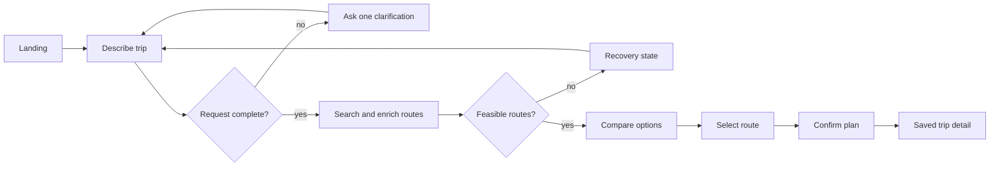

# Detour design plan

This directory is the implementation contract for the first Detour MVP. It
defines what the product does, how every screen behaves, which decisions are
made by an LLM versus deterministic code, and the architectural constraints
that future implementations must preserve.

## Documents

- [Functional specification](FUNCTIONAL_SPEC.md): routes, user flows, states,
  components, accessibility, and responsive behavior.
- [Technical plan](TECHNICAL_PLAN.md): architecture, data model, internal APIs,
  external providers, algorithms, privacy, observability, and tests.
- [Architecture decisions](ARCHITECTURE_DECISIONS.md): chosen system boundaries,
  rejected alternatives, algorithm tradeoffs, data lifecycle, and failure
  policy.
- [`prototype.html`](prototype.html): an interactive, static reference for all
  screens. From the repository root, run `python3 -m http.server` and open
  `http://localhost:8000/docs/design/prototype.html`.
- [`screens/`](screens/): the nine approved desktop design targets embedded in
  the root README.

## Product boundary

Detour is a commute-planning copilot, not a ticket seller. For the first MVP it
does five things:

1. Turns a natural-language trip request into typed constraints.
2. Retrieves or loads a small set of possible ground-transit routes.
3. Enriches the routes with weather and disruption evidence.
4. Ranks feasible routes and explains the recommendation.
5. Saves one route only after explicit user confirmation.

The MVP intentionally excludes ticket purchase, payment handling, email and
calendar OAuth, automatic rebooking, background monitoring, and broad
nationwide coverage. These exclusions keep the golden path demoable and make
the safety boundary obvious.

## Golden path

## Route inventory

| Route or state | Purpose | Primary action |
| --- | --- | --- |
| `/` | Explain the hook and establish trust | Plan a trip |
| `/plan` | Capture conversational and structured constraints | Find routes |
| `/plan/results` | Compare options and explain the recommendation | Confirm this plan |
| `/trips` | Review upcoming and previous confirmed plans | Open a trip |
| `/trips/:id` | Show itinerary, risks, freshness, and backup | Refresh status |
| `/settings` | Edit ranking preferences and inspect providers | Save preferences |
| Loading state | Show transparent planning progress | Cancel or wait |
| No-routes state | Explain why nothing qualified | Edit request |
| `/*` | Recover from an unknown URL | Back to planning |

## Shared design language

- A warm near-black or off-white canvas with a soft green action color.
- Editorial serif headings paired with a practical sans-serif UI font.
- Route cards show departure, arrival, duration, transfers, risk, and price in
  the same positions so comparisons are scannable.
- The selected route is paired with a recommendation panel; selection color is
  never the only status signal.
- One high-emphasis action per view. Destructive or externally visible actions
  always require confirmation.
- Empty, loading, unavailable, stale-data, and not-found states are first-class
  screens rather than afterthoughts.

## Design package completeness

- Every route and non-happy-path state has a checked-in screenshot.
- Screen behavior and navigation are specified without relying on the images.
- Shared components and their proposed Jac files are named.
- Typed internal contracts and provider boundaries are documented.
- The ranking algorithm is deterministic, measurable, and testable.
- Live API assumptions, costs, quotas, and fallbacks are explicit.
- MVP and deferred scope are separated.
- Component boundaries and dependency direction are explicit enough for
  independent implementation without redefining the product.

This design package does not claim that the designed behavior already exists.
Its purpose is to let the team agree on the product and technical boundary
before implementation begins.

## Team decisions to approve in review

1. Keep **Detour** as the working name or replace it before implementation.
2. Use Ann Arbor to Chicago as the first supported/demo corridor.
3. Approve fixture-backed routing as the honest MVP baseline.
4. Approve the balanced score weights and user-facing preference presets.
5. Decide whether the team can enable a billed Google Cloud project for live
   route data; fixture-backed planning does not depend on this decision.
6. Choose the authentication approach before persistence work begins.
