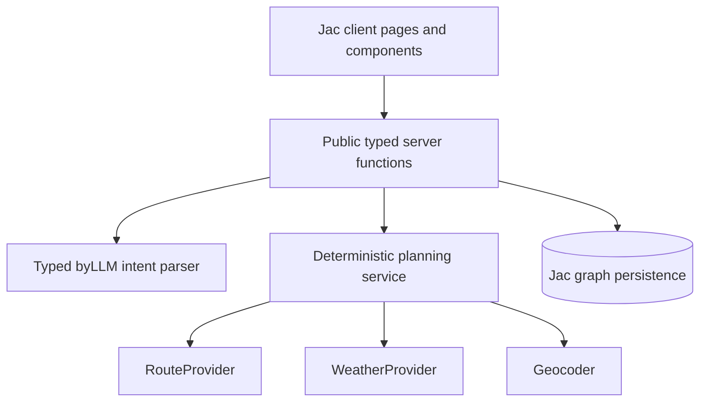

# Technical plan

## Current state

The repository currently serves a client-only Jac landing page from `web/`.
There are no server endpoints, persistent trip objects, app routes, LLM calls,
or external data adapters yet. This plan describes proposed work; it does not
describe implemented behavior.

## Architecture



Jac's client/server compiler can expose server `def:pub` functions to client
components through a generated bridge. The implementation should keep external
HTTP calls and secrets on the server, with typed objects shared across the
boundary.

## Proposed modules

```text
web/
  main.jac
  frontend.cl.jac
  pages/
  components/
  server/
    models.jac
    api.jac
    parser.jac
    planner.jac
    persistence.jac
    providers/
      base.jac
      fixtures.jac
      geocoding.jac
      weather.jac
      routing.jac
  fixtures/
    ann-arbor-chicago.json
tests/
  parser_tests.jac
  planner_tests.jac
  api_tests.jac
```

The exact folder names may change to fit the installed Jac compiler, but the
dependency direction should not: pages call typed server APIs; the planner uses
provider interfaces; providers never depend on UI modules.

## Domain model

| Type | Important fields |
| --- | --- |
| `TripRequest` | origin text, destination text, local date, time constraint, max price, transfer preference, allowed modes |
| `Place` | display name, latitude, longitude, time zone, provider ID |
| `RouteOption` | ID, provider, legs, depart/arrive, duration, transfers, price, freshness |
| `RouteLeg` | mode, operator, service, origin, destination, times, status |
| `WeatherEvidence` | point, valid time, precipitation, wind, alert severity, source timestamp |
| `RiskAssessment` | delay, transfer, weather, missing-data risks, reason codes |
| `ScoredRoute` | option, normalized features, total score, explanation reasons |
| `TripPlanDraft` | normalized request, ranked routes, selected ID, provider metadata |
| `TripPlan` | owner, confirmed option, backup option, created time, latest snapshot |
| `UserPreferences` | priority preset, max price, min transfer buffer, avoided modes |

Persist only confirmed `TripPlan` objects and user preferences. Planning drafts
can be short-lived server state or carried by an opaque ID with an expiration.
Never put provider API keys, raw model prompts, or unrelated email/calendar
data in graph nodes.

## Internal API contract

These are conceptual Jac `def:pub` signatures. Concrete code must adapt syntax
to the compiler guides installed in the project and run `jac check`.

| Function | Input | Output | Side effect |
| --- | --- | --- | --- |
| `parse_trip_request` | raw text plus known fields | `ParseResult` | LLM call only |
| `plan_trip` | complete `TripRequest` | `TripPlanDraft` | Provider reads; temporary draft |
| `confirm_trip` | draft ID and route option ID | `TripPlan` | Persists confirmed plan |
| `list_trips` | optional status filter | `list[TripSummary]` | None |
| `get_trip` | trip ID | `TripPlan` | None |
| `refresh_trip` | trip ID | `TripPlan` | Provider reads; stores new snapshot |
| `get_preferences` | none | `UserPreferences` | None |
| `save_preferences` | `UserPreferences` | `UserPreferences` | Persists preferences |
| `get_source_status` | none | `list[ProviderStatus]` | Lightweight health/cache reads |

All public functions validate ownership server-side. Errors cross the boundary
as typed codes (`INVALID_REQUEST`, `CLARIFICATION_REQUIRED`, `NO_ROUTES`,
`PROVIDER_UNAVAILABLE`, `NOT_FOUND`, `SAVE_FAILED`) rather than raw provider or
model exceptions.

### Example planning request

```json
{
  "origin_text": "Ann Arbor, MI",
  "destination_text": "Chicago, IL",
  "date": "2026-10-23",
  "time_kind": "DEPART_AFTER",
  "local_time": "16:00",
  "max_price": {"amount": 50, "currency": "USD"},
  "min_transfer_minutes": 30,
  "allowed_modes": ["TRAIN", "BUS"]
}
```

### Example result envelope

```json
{
  "draft_id": "draft_01",
  "request": {"origin_text": "Ann Arbor, MI", "destination_text": "Chicago, IL"},
  "routes": [
    {
      "id": "wolverine_355",
      "score": 82.4,
      "reason_codes": ["FASTEST_DIRECT", "WITHIN_BUDGET", "WEATHER_BUFFER"],
      "data_mode": "FIXTURE",
      "fresh_at": "2026-10-16T19:00:00Z"
    }
  ],
  "recommended_route_id": "wolverine_355"
}
```

## LLM boundary

Use Jac byLLM for one bounded task: convert conversational text into a typed
`TripIntent` with optional fields and a confidence/clarification result. Typed
structured output prevents ad-hoc JSON parsing. Use semantic annotations to
define time constraints and travel modes.

The LLM must not:

- invent schedules, fares, delays, weather, or booking availability;
- rank routes directly;
- call side-effecting tools;
- persist a trip or act on an external account.

The parser is tested with `MockLLM` and fixed outputs. Production parsing must
catch authentication, rate-limit, model, and output-conversion failures and
fall back to the structured form.

## Provider plan

| Capability | MVP choice | Later option | Decision rationale |
| --- | --- | --- | --- |
| Route planning | Committed corridor fixtures | Google Routes transit adapter | Guarantees a testable demo; live coverage and billing remain a bounded spike |
| Transit metadata | Data embedded in normalized fixtures | Transitland v2 REST | Useful GTFS lookup and alerts, but ordinary REST is not a journey planner |
| Geocoding | Local corridor place map | Carefully rate-limited Nominatim or paid provider | Avoids turning public Nominatim into autocomplete and removes a demo dependency |
| Weather | Recorded NWS responses, then live NWS | Alternate weather provider behind the same interface | Free US forecast and alert data with explicit provenance |
| Language understanding | Typed byLLM plus `MockLLM` tests | Different configured models | Keeps model choice separate from product and ranking logic |

Pricing, quotas, coverage, and service terms can change. Re-check them when
live-provider work begins rather than treating this design snapshot as a
permanent contract.

### Route data

**MVP default: `FixtureRouteProvider`.** Commit a small, clearly labeled Ann
Arbor to Chicago dataset. This makes the full flow deterministic and reviewable
before credentials or live coverage exist.

**First live spike: Google Routes API in transit mode.** It can return transit
itineraries, alternate routes, transit details, and sometimes fares. It
requires a billed Google Cloud project and an API key, so the key remains
server-side and a daily quota must be configured.

**Data-enrichment option: Transitland v2 REST.** It provides GTFS-derived
routes, stops, trips, schedules, and alerts behind an API key. Its ordinary
REST endpoints are useful for data lookup but are not a full journey planner;
the Transitland routing API is beta and paid. Do not block the MVP on it.

The provider interface must make `data_mode` (`FIXTURE`, `LIVE`, `CACHED`) and
`fresh_at` mandatory so the UI can disclose provenance.

### Geocoding

For the demo, resolve a small allowlist of known corridor locations locally.
If public Nominatim is used for user-submitted searches, requests must be
server-proxied, cached, limited to at most one request per second, identified by
a real application User-Agent, and must not implement autocomplete. A provider
interface is required so production can switch services without a client
release.

### Weather

Use the US National Weather Service API for domestic trips:

1. `GET /points/{lat},{lon}` discovers the forecast grid.
2. Follow `forecastHourly` for departure, transfer, and arrival windows.
3. Query active alerts for relevant areas.

NWS requires an identifying User-Agent and is cache-friendly. Cache the point
to grid mapping and short-lived forecast responses. Provider outages degrade
weather to unknown; they do not erase route options.

### Real-time transit

When a route provider exposes GTFS Realtime trip updates or alerts, normalize
them into delay, cancellation, and freshness fields. Absence of a trip update
means “no real-time data,” not “on time.” Stale update thresholds must be
configurable and visible in provider metadata.

## Planning algorithm

The pipeline is deliberately hybrid:

1. **Parse.** byLLM maps text to typed, optional intent fields.
2. **Clarify.** Deterministic validation asks one question if origin,
   destination, date, or time semantics are missing or contradictory.
3. **Resolve.** The geocoder converts locations to coordinates and time zones.
4. **Search.** The route provider returns candidate itineraries.
5. **Enrich.** Weather, alerts, and available real-time evidence are attached.
6. **Filter.** Hard constraints remove canceled routes, routes outside the
   requested time window, routes above a strict price cap, or transfers below
   the user's minimum buffer.
7. **Featurize.** Convert remaining routes into comparable duration, price,
   reliability, transfer, weather, and uncertainty utilities in `[0, 1]`, where
   higher is better.
8. **Score.** Apply deterministic weights and an uncertainty penalty.
9. **Explain.** Produce reason codes from the actual feature deltas. Templates
   render the default explanation; an LLM may rewrite it only if all facts are
   supplied and the result remains non-authoritative.
10. **Confirm.** Persist only the selected route after the user acts.

### Balanced score

```text
base = 0.30 * duration_utility
     + 0.25 * reliability_utility
     + 0.20 * price_utility
     + 0.15 * transfer_utility
     + 0.10 * weather_utility

score = 100 * base - 10 * uncertainty
```

Utilities are normalized across the current candidate set. A dimension that is
missing for every route receives a neutral value and does not create a false
advantage. Missing data increases `uncertainty` instead of being treated as a
failure or a perfect value.

Preference presets alter weights but not the pipeline. For example, **Fastest**
raises duration weight, while **Most reliable** raises reliability and transfer
weights. Store the effective weights with the draft so a recommendation is
reproducible.

Tie breakers, in order: fewer transfers, earlier arrival, lower known price,
then stable provider route ID. Identical normalized inputs must always produce
the same order.

### Risk rules

- A cancellation makes a route infeasible.
- A transfer below the user's minimum buffer makes a route infeasible; a
  transfer within 15 minutes above the minimum receives a warning.
- A provider-predicted delay is capped for scoring at 60 minutes but its full
  value remains visible.
- Severe NWS alerts in a relevant trip window create a high weather risk;
  lesser precipitation, wind, or cold can create advisory reason codes.
- Stale or missing real-time data increases uncertainty and is labeled unknown.

## Persistence and security

- Attach confirmed plans and preferences to the current Jac user root or
  equivalent authenticated owner.
- Check ownership on every read and mutation, including refresh.
- Keep provider and LLM keys in server environment configuration.
- Never return keys, raw provider headers, full prompts, or stack traces to the
  client.
- Log request IDs, typed error codes, duration, provider name, and freshness;
  avoid raw free-text trip requests by default.
- Do not add payment data, ticket PDFs, inbox access, or calendar scopes in MVP.

## Caching and timeouts

| Operation | Suggested timeout | Cache |
| --- | --- | --- |
| Intent parse | 8 s | No shared cache; optional per-request retry |
| Geocode | 3 s | Long-lived by normalized query |
| Route search | 8 s | 2–5 minutes for identical queries |
| NWS point mapping | 3 s | 7 days, periodically revalidated |
| NWS forecast/alerts | 5 s | Respect response expiry; target 5–15 minutes |
| Saved trip read | 2 s | Client request cache allowed |

Provider calls may run concurrently after place resolution. Overall planning
should stop after 12 seconds and return a typed partial or unavailable state,
never an endless spinner.

## Test strategy

### Unit

- Intent validation and clarification selection.
- Utility normalization, weight presets, hard constraints, uncertainty, and
  deterministic tie breakers.
- Weather and GTFS normalization from committed fixtures.
- Explanation reason codes match the measured feature differences.

### Contract

- Each provider adapter converts representative responses into the same typed
  objects and handles malformed, stale, timeout, and rate-limit responses.
- `MockLLM` covers complete, incomplete, malformed, and contradictory intents.

### Integration

- Plan from a committed request and fixture dataset.
- Confirm the second-ranked route and verify that exact option persists.
- Ensure one user cannot read another user's trip.
- Simulate each typed error and verify the matching recovery state.

### Browser

- Golden path from `/plan` through saved trip detail.
- Keyboard-only route selection and confirmation.
- Direct navigation, back/forward behavior, mobile layout, loading, no routes,
  stale data, and 404.

### Evaluation

Maintain a small checked-in corpus of requests and expected typed fields. Track
field accuracy, clarification rate, false assumptions, end-to-end completion,
provider latency, and recommendation reproducibility. Do not grade the system
only on how natural its prose sounds.

## External references

- Jac client/server bridge and public functions:
  <https://docs.jaseci.org/quick-guide/what-makes-jac-different/>
- Jac byLLM structured outputs and mocking:
  <https://docs.jaseci.org/tutorials/ai/structured-outputs/>
- NWS API: <https://www.weather.gov/documentation/services-web-api>
- Nominatim usage policy:
  <https://operations.osmfoundation.org/policies/nominatim/>
- Transitland v2 REST API: <https://www.transit.land/documentation/rest-api/>
- GTFS Realtime trip updates:
  <https://gtfs.org/documentation/realtime/feed-entities/trip-updates/>
- Google transit routes:
  <https://developers.google.com/maps/documentation/routes/transit-route>
