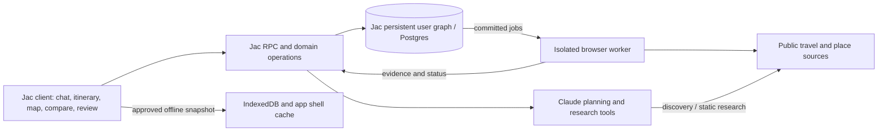

# Conversational trip planner: product and architecture proposal

Status: proposed design baseline, awaiting confirmation. November 14, 2026. This document specifies intended behavior; it does not claim the application implements it. The agreed product decisions are recorded separately in [the interview decision log](trip-planner-decisions.md).

## Product contract

Help one planner turn a travel request into a usable U.S. trip, through conversation and a linked visual workspace. The planner can organize a whole party. A short professional trip can end with flights, a hotel if needed, and local transport. A vacation can develop into an Arizona-style timed itinerary with overnight bases, driving legs, activities, meals, breaks, daylight constraints, and alternatives. An activity schedule is never compulsory.

The trip is a persistent structured plan. Chat explains, asks, researches, and proposes changes. The map, itinerary, comparisons, and review panels make the plan inspectable. Every proposed trip change needs approval; browsing and research do not.

Planning depth is inferred and confirmed in conversation. Pacing is a separate preference. A detailed trip can be relaxed; a loose itinerary can still involve long driving days. Preferences can be learned across trips, reviewed, and forgotten. Current explicit trip instructions take precedence over learned preferences; this precedence rule is a design recommendation for confirmation.

Travel data must be free. Use search and interactive browser research, with Anthropic credits available for the model. Supplier names and verified source links appear on cards. No commercial partner access is a product prerequisite. Booking happens on provider websites.

## User experience

### The workspace

Recommended desktop composition: a conversation column, an active itinerary/detail column, and a linked map. The detail column switches between itinerary, comparison, and change review; it does not create a fourth permanent column. This placement is a recommendation, not a previously chosen pixel layout.

| Surface | What it does | What an interaction means |
| --- | --- | --- |
| Chat | Understand intent, ask one important clarification, explain findings, propose changes | Sends a conversational request; never edits the trip immediately |
| Itinerary | Route, overnight bases, day outline, and optional detailed schedule | Select a day/item to inspect and focus the map |
| Map | Show intended journey, day stops, relevant candidate locations, and calculated routes when available | Select a location for details; no dragging or direct trip editing |
| Comparison | Curated source-branded offers with consistent fields and relevant tradeoffs | Inspect an option or request a proposal selecting it |
| Review | Show proposed changes, dependent consequences, conflicts, and affected costs | Approve the coherent proposal, or ask for a revision |
| Trip overview | Dates, party, chosen transport/stays, missing decisions, and cost coverage | View trip state; ask for changes in chat |

On a phone, use one primary surface at a time: itinerary, map, or chat. Comparisons and review open as full-width views, with the current day/item context preserved. Approval must show every affected part, not only the change visible in the current viewport. Exact responsive breakpoints are implementation choices.

Chat should normally contain a short answer, its reason or consequence, and the next useful decision. Details belong in expandable explanations or the relevant visual panel. Do not enforce a brittle word-count validator; long reasoning remains available when requested. Use real research status such as “Checking Tucson stays,” with cancellation. Do not invent percentages or imply the app is checking a source it has not opened.

### Starting a trip

Begin with an empty conversational entry, not a mandatory form or a Professional/Vacation mode selector. Let users describe a vague idea, a fixed route, a work commitment, or an existing plan. The model infers the appropriate depth and confirms it naturally.

Gather only inputs that materially affect the next action. For a quote, dates and the party details needed by that category are prerequisites; a driver's age or a discount membership may affect rental prices. Ask about budget when it becomes relevant and accept “no fixed budget.” Preserve unknowns explicitly rather than filling them with plausible values.

Accept pasted text and uploaded documents/images. Extract proposed structured facts and connect them to their source attachment. Keep uncertainty visible in the extraction preview. The user's supplied booking or itinerary is evidence of what they supplied; it is not independent verification of current opening hours or live availability.

For someone without a destination, propose a small set of destination directions with reasons tied to their constraints. Once one is chosen, develop the route and overnight bases. Do not make destination discovery a compulsory stage for someone who already knows where they are going.

### Professional-trip example

The following is interaction design, with no claim about actual inventory or prices.

| Turn | Visible conversation | Workspace and state |
| --- | --- | --- |
| User | “I need to be in San Francisco for meetings Tuesday and Wednesday. Hotel is already booked.” | Read request; extract known commitments and unresolved dates. |
| Assistant | “I’ll focus on getting you there and back. What are the meeting dates?” | Brief clarification. No sightseeing plan. |
| User | Supplies exact dates and booked hotel confirmation | Preview extracted commitment; user approves. Hotel becomes a fixed trip item. |
| Assistant | Asks origin and any materially missing quote inputs | Trip summary shows known commitments and unresolved transport. |
| Research | “Comparing flights around your meeting times.” | Compare verified date/party-matched flight offers. Show required ground transfer as unresolved if not yet planned. |
| User | “Use the later return.” | Prepare selection proposal with total and evidence time; no booking implied. |
| Review | “Add this flight option; keep your hotel.” | Approval creates a new trip revision. Booking link opens provider site. |
| User | “Booked it.” or uploads confirmation | Preview booking-status update. Approval records a user-reported or document-supported booking. |

### Arizona-style example

Use the user's December 26–January 4 Arizona itinerary as an import and revision acceptance scenario. Times in that pasted itinerary are user-supplied and initially unchecked.

| Turn | Visible conversation | Workspace and state |
| --- | --- | --- |
| User | Pastes the Arizona plan | Extraction preview: arrival/departure, ten days, overnight bases, stops, times, optional alternatives, and supplied closure notes. |
| Assistant | “I’ve mapped your plan. I also found a conflict between your Meteor Crater arrival and its closing-time note. Would you like me to check the daily timing?” | A contextual conflict linked to the two imported facts. Do not claim an independently verified closure yet. |
| Approval | User accepts the imported structure | Approved high-level trip is visible. Detailed schedule remains provisional until checked. |
| Research | Check route duration, operating/access rules, reservation constraints, and date/location-specific daylight where relevant | Show field-level evidence and estimated durations. Flag infeasibility without silently deleting stops. |
| User | “Give Sedona another night, keep our booked Page hotel, and avoid adding more long drives.” | Build one connected proposal; preserve the Page commitment. |
| Assistant | Explain the actual tradeoff once solved | Preview affected dates, overnights, activities, travel, and budget. If the constraints conflict, present the unresolved tradeoff and ask the user. |
| User | Requests a narrower alternative or approves | Replace the pending proposal or apply it atomically. The previously approved trip remains visible until approval. |

Do not assume an extra night is feasible or invent the concrete revised dates in this example. The model must solve against the actual imported commitments.

### Comparisons and source identity

Show a small curated shortlist first, with the ability to request more. Group comparisons by the user's current decision and exact query. A source badge/name and direct source link are required; use appropriate provider brand assets when available without imitating the provider's whole website.

Shared fields: source, product identity, exact query dates/party, total and currency, included compulsory charges, relevant location/timing, important product restrictions, observation time, and booking link. Category-specific fields include flight segments and fare/baggage selection, room/unit composition and cancellation policy when evidenced, or rental pickup/drop-off details and selected vehicle class. Missing optional details are shown as unknown; mandatory quote details cannot be missing.

Offer selection creates a proposal. It does not edit the approved trip or mark anything booked. Presentation-only selection can highlight a map location without asking for approval. A future contextual “ask about this” action would attach stable item references to chat; annotation is still an optional idea, not a committed feature.

### Approval and revision behavior

Recommended policy: one active change proposal per trip, with a coherent group of related changes. Ask the user to refine it in chat before approval if they want only part of it. Do not provide independent field approvals that could leave a dependent schedule inconsistent. This batching policy is a design recommendation for confirmation.

The review shows a short summary and the actual differences in the affected itinerary/map. Label it “Proposed,” retain access to the approved version, and make additions/removals/date moves explicit. The primary action approves the displayed proposal; rejection or conversational refinement keeps the current revision intact. Initial route creation and imported-trip extraction use this same mechanism.

Approval and verification are separate axes. A high-level route can be approved while activities are undeveloped. A provisional detailed schedule is shown early, then checked before final schedule approval. Selecting a currently verified offer does not reserve or lock its price. Imported bookings use their documented or user-reported status, not a new live-offer availability test.

An already-booked item remains fixed unless the user explicitly requests a change. The app proposes a possible cancellation/rebooking consequence; it does not perform it. “Keep this hotel” can mean the property, selected rate, or an existing booking; clarify when that distinction changes feasibility.

## State, contracts, and guarantees

### Domain model

These are conceptual typed entities, not unverified Jac syntax.

| Entity | Essential content |
| --- | --- |
| Trip | ID, owner, title, party, explicit constraints, planning depth, current revision |
| TripRevision | Immutable accepted plan snapshot/operations, parent revision, applied command, creation time |
| Day | Local calendar date, overnight base, ordered items, planning/evidence state |
| PlanItem | Stable ID, kind, place, local times/time zone, duration/buffer, fixed/flexible status, evidence references |
| TravelLeg | Endpoints, mode, route evidence, estimated vs sourced duration, selected transport reference |
| Stay | Location/property, check-in/out dates, occupied nights, rooms/party, selection or booking reference |
| Booking | User-reported/document-supported status, product/commitment details, price paid if supplied, private confirmation reference |
| CandidateOffer | Query fingerprint, observed source product, evidenced total/availability, source link, observed time, lifecycle |
| Proposal | ID, base revision, typed changes, reasons, dependent effects, evidence, unresolved conflicts, lifecycle |
| ResearchJob | Task/inputs, base revision/query fingerprint, progress, attempts, cancellation, lease, result references |
| Evidence | Source URL, observation time, exact query, field anchors and captured page/attachment reference |
| ConversationTurn | Role/content, contextual entity IDs, tool/job/proposal references, turn idempotency key |
| PreferenceMemory | Reusable preference, source turns, trip-specific context, learned time, review/forget lifecycle |
| Attachment | Scoped metadata, storage reference, extraction state, evidence links |

Keep accepted plans, proposed changes, evidence, and conversation history separate. Candidate research and conversation autosave are not changes to the accepted itinerary. Automatic preference learning is the user's explicit exception to per-change trip approval.

Amounts use integer minor currency units or exact decimal values, never floating-point arithmetic. Budget summaries distinguish booked/paid amounts, selected offers observed at a stated time, and unpriced sections. Do not label a partial subtotal “trip total,” combine alternatives, or silently add estimates to verified amounts. An estimate, if useful in early destination exploration, stays a separate labeled range outside the verified subtotal.

Store date-only intentions as local dates; store timed events with their applicable time zone and disambiguation. Resolve places/time zones through data, not model-invented coordinates. Anchor relative language to an explicit user-local current date and clarify ambiguous phrasing. Preserve stated optional activities, buffers, open days, and vague timing instead of forcing precision.

### Model output and rendering

Use one planning orchestrator with tools, rather than a collection of independently mutating agents. Parallel research jobs can serve independent tasks. The model interprets intent, proposes routes/schedules, decides useful questions, chooses research actions, and explains tradeoffs. Application code validates typed operations, authorization, revisions, arithmetic, dates, connectivity, and fixed-commitment constraints.

Recommended response envelope:

```json
{
  "assistantMessage": "Short conversational response",
  "clarification": null,
  "proposalId": "proposal-id-or-null",
  "researchJobIds": [],
  "viewHints": {"panel": "review", "focusItemIds": []}
}
```

This is a contract illustration; actual JSON should use `null` where appropriate rather than placeholder strings. View hints choose from app-owned components. The model does not generate executable UI code or derive canonical state from rendered prose. Contextual references are explicit item IDs plus their revision, not ambiguous display positions such as “the third hotel.”

Native cited research and strict JSON generation require careful separation: current Anthropic documentation identifies incompatibilities between strict JSON and citation-enabled document/search-result content. Capture cited evidence first, then normalize a typed proposal with app-owned evidence IDs. Schema validity proves structure, not the truth of a price. [Structured outputs](https://platform.claude.com/docs/en/build-with-claude/structured-outputs), [citations](https://platform.claude.com/docs/en/build-with-claude/citations)

### Proposal application

An approval request includes trip, proposal, expected base revision, and command idempotency key. In one authenticated write request: verify ownership, detect duplicate command, verify the proposal still targets the current revision, validate constraints, create the next revision, mark the proposal applied, and record the command result.

A stale proposal is not silently rebased or applied to a newer plan. Explain that the trip changed and create a fresh preview. Retrying a successful approval returns its existing result. Reading and updating the revision must not be split across requests.

The installed Jac persistence reference documents serializable transactions, rollback, and conflict replay for writing served units. Use that native boundary, plus application-owned revision/idempotency logic. Keep model calls, browser work, and non-idempotent external effects outside retried write transactions. A committed research-job record lets recoverable workers perform the external work after commit; an in-memory callback alone is not a durable queue.

### Search evidence and the offer gate

An offer card requires observed evidence matching the exact requested itinerary/stay/rental, dates, party and applicable product inputs, available product, currency, total including compulsory charges, and a usable source booking handoff. Store observation time and query fingerprint. Date parameters in a URL alone, snippets, a generic nightly rate, or the model's assertion are insufficient.

Record the visible search state and the resulting offer state so a verifier can connect the total to the exact inputs. Capture field anchors and enough raw page text/screenshots to audit the extraction. Prefer directly observed structured/page fields over model guesses. A validator can enforce completeness and parameter agreement, but source-semantic fidelity still needs extraction audits and adversarial testing; a second model's confidence is not a substitute for evidence.

Offer validity is observational, not a reservation guarantee. Refresh before displaying a stale offer as currently available and before an external booking handoff. Exact refresh thresholds should be determined through provider experiments; do not invent a universal freshness guarantee. When dates/party/product inputs change, invalidate matching eligibility immediately. Old research can remain in history but cannot appear as a current verified offer.

If thorough research and bounded retries cannot establish a qualifying result, keep the relevant section unresolved and explain the specific gap. Do not fill an empty comparison with unverified cards. An external-search fallback is not assumed to be a requirement.

## Architecture recommendation



### Jac and persistence

Use Jac for the client, server endpoints, typed domain entities, and account-root graph persistence. Connect trips, revisions, items, proposals, jobs, and evidence through the authenticated user's root. Avoid turning every scalar field into its own node. Reuse current Jac account integration and geographic/map work where it meets the new contract.

Anonymous `:pub` calls share a guest root; do not use it as isolated per-guest trip storage. Recommended guest design: recoverable local IndexedDB draft with explicit version; anonymous interpretation/research requests use bounded submitted context and a scoped, unguessable job capability for temporary results. That capability authorizes only its job, not graph traversal or another guest's work. Public research and upload abuse limits are required application infrastructure, not existing capabilities.

On sign-in, import the local draft with an idempotent claim/import command. Validate it server-side, associate it with the account, preserve history and pending proposal references, and retain the local recovery copy until server acknowledgement. Resolve conflicting copies explicitly instead of overwriting an existing account trip. Account trips then use the server as the authority, with local read/recovery caches.

Persist account revisions, proposals, research jobs, conversation, and preferences. Store uploaded binaries and larger evidence captures outside graph rows, with scoped metadata links. Jac supports multipart uploads and local/S3-compatible storage, but this app has not implemented that pipeline. Exact attachment size/type/retention policies belong to implementation design and must be explicit before enabling uploads.

### Research runtime

Use Anthropic native search/fetch for discovery and suitable static evidence. Fetch freshness controls do not turn it into an interactive browser. For JavaScript booking sites and date/party forms, run an isolated Chromium browser controlled by Claude's documented browser toolset through an application-owned driver. Anthropic's browser tool supplies the model interface; the app supplies browser execution and hosting. [Search](https://platform.claude.com/docs/en/agents-and-tools/tool-use/web-search-tool), [fetch](https://platform.claude.com/docs/en/agents-and-tools/tool-use/web-fetch-tool), [browser tool](https://platform.claude.com/docs/en/agents-and-tools/tool-use/browser-use-tool), [browser SDK](https://platform.claude.com/docs/en/agents-and-tools/tool-use/browser-use-sdk)

Keep direct provider SDK/HTTP orchestration behind a narrow server adapter if needed for these tool capabilities. Jac remains responsible for the application and state. Do not add a second LLM orchestration layer merely to make the app appear more Jac-native. Use `by llm` where the pinned compiler supports a task cleanly, with explicit contracts; prove support before relying on an advanced provider feature through it.

Jobs are committed before a worker claims them. Claim/heartbeat/expiry, bounded attempts, cancellation, and checkpoints are app-owned. Results carry the originating query and revision. A cancelled job or stale result can preserve audit evidence but must not change the current plan or publish current offers. Process-level async alone is not a durable queue. Start with one worker service and a database-backed job ledger; add queue infrastructure only if measurements justify it.

Use the same separation for model planning turns that will create proposals: submit the turn and committed job, perform the model/tool loop outside the request transaction, then commit its response/proposal in a short result operation. The client observes progress and the resulting response envelope. This prevents a transaction replay from duplicating a model call or browser search.

Provider webpages are data, not instructions to the planning agent. Browser execution stays scoped to research and external handoffs; no checkout/payment actions. Browser sessions and source content must not get access to application secrets or other users' attachments. These are server implementation responsibilities, not extra approval dialogs in the user flow.

Anthropic credits cover eligible model/tool usage under the actual credit terms; browser execution and hosting remain external resource dependencies. Measure tool turns, tokens, runtime, and completion rate. Configure per-job step/time/retry ceilings and a stop action before allowing autonomous research. Do not choose arbitrary limits as proven acceptable latency or spend. [API billing](https://support.claude.com/en/articles/8977456-how-do-i-pay-for-my-claude-api-usage)

### Operation boundaries

| Operation | Intent and response |
| --- | --- |
| Planning turn | Submitted message + selected references + base revision; return response envelope, proposal, and/or research job references |
| Start/poll/cancel research | Validate query scope; return real task progress and evidence/offer references |
| Apply proposal | Ownership + idempotency + base-revision check; commit new revision or return a conflict |
| Import guest draft | Validate and deduplicate local work; acknowledge durable account copy |
| Upload/extract attachment | Scope content; produce evidence and a proposal, not silent trip mutations |
| Load trip/revisions | Owner-authorized view models, not arbitrary graph-node access |
| Review/forget preferences | Inspect and remove learned personalization; explicit trip facts remain separate |

Exact endpoint signatures and streaming/polling transport should follow the pinned guides and a working compiler check. Existing `main.jac` imports only selected RPCs; new endpoints must actually be exposed and exercised, not merely defined in an unused module.

### Offline use

Cache the approved itinerary, addresses, and imported booking details selected for offline reading, with a visible saved timestamp/version. Account sign-out clears device-scoped private caches; provide explicit local-cache removal. Live comparison, maps, routing, new research, and conversational planning require internet. An offline view must not imply that a previously observed price is still current. Uploaded source files do not need to be cached in full to preserve their extracted booking details.

## Existing-code migration

| Existing area | Proposed treatment |
| --- | --- |
| `web/components/AtlasStudio.jac` | Replace its monolithic interaction contract with the structured workspace/proposal flow; preserve useful map/selection behavior through extracted components |
| `web/client/atlas_state.jac` | Reuse recovery/malformed-storage lessons and add explicit legacy import; do not silently migrate a journey into a complete checked trip |
| `web/server/atlas_service.py` | Reuse catalog normalization and selected route-provider utilities after focused tests; replace the route-only interpretation contract |
| `web/server/atlas_flights.py` | Treat as prior search-lead work, not inventory or quote verification; do not publish its current links as priced offer cards |
| `web/client/account.jac` | Reuse runtime login/signup integration; replace browser-only ownership assumptions with server-authorized trip persistence |
| Existing commuter Plan/Trips | Preserve during isolated development; decide and document final navigation before switching the primary flow. Their fixture results must never masquerade as new live travel results |
| Existing Atlas journeys | Offer reviewed import of route/history information, preserving status and original data. Missing nights/activities remain missing |
| Current uncommitted work | Inspect and preserve; no broad reset or replacement without reviewing the actual diff |

Recommended navigation target is one primary trip-planning workspace plus a trip list and account/preferences. History import can be available there without retaining two competing planning experiences. Final branding/navigation replacement is a proposal, not an already-agreed rename.

## Validation and implementation sequence

This sequence follows dependency and uncertainty, not a deadline. Each stage has an observable end-to-end outcome. No application implementation has been authorized by this planning document.

1. **Prove free research.** Run an interactive browser experiment for flight, hotel, vacation rental, and car queries. Observe exact dates, party, available product, compulsory-charge total, timestamp, and selected-offer handoff. Repeat with changed dates/party and clean sessions on the intended deployment network. Include mainland, Alaska, and Hawaii routes where coverage is claimed. Record failures, latency, and resource use. Current search-only lodging evidence does not pass this experiment.
2. **Prove state and approval.** A chat request produces a typed preview; approved state stays unchanged until apply; acceptance creates exactly one revision. Test rejection, refinement, stale proposals, duplicate approval, and worker results arriving after edits. A tiny vertical slice with one trip section is sufficient to validate the contract.
3. **Deliver the linked workspace.** Guest can start, see a route/day outline and map, inspect items, and approve conversational revisions. No direct visual mutation. Desktop and phone retain context; chat remains concise and accessible.
4. **Deliver account continuity and imports.** Guest work survives sign-in; trips resume on a second device; pasted plans and uploads produce reviewed extraction; approved details are readable offline. Verify actual database/file durability across restarts.
5. **Deliver real option decisions.** The validated research pipeline fills source-branded comparisons; selection creates a proposal; approved option has a working provider handoff. Missing mandatory evidence prevents a card. Refresh and revision invalidation work.
6. **Deliver detailed vacation planning.** Compose and check daily schedules, driving, night allocation, breaks, opening/access rules, reservation anchors, daylight, and optional alternatives. Support a lightly planned day alongside a detailed one.
7. **Complete the full journeys and polish.** Run the professional-trip and Arizona import/revision flows; test missing data, cancelled research, stale prices, uploaded ambiguity, offline access, and learned-preference review/forget. Resolve legacy navigation and data migration. Then choose the first release boundary from demonstrated coherent flows.

### Acceptance scenarios

- Logistics-only work trip with hotel already booked: no forced sightseeing workflow; correct meeting/flight timing and preserved hotel commitment.
- Vague vacation: discover destinations, approve a direction, then route/bases and detail. No compulsory full intake.
- Arizona import: cross-year dates, optional stops, rests, drive buffers, and supplied twilight/closure notes survive; the internal closure conflict is flagged; unverified values retain provenance.
- Mixed route: “fly DTW to SFO, come back to XNA and drive to Ann Arbor a few days later” retains every intended endpoint/mode; clarify timing separately.
- Relative dates: explicit current date/time zone, exact expected dates, clarification for ambiguous wording, and short answers to follow-ups.
- Revision: “another night in Sedona, keep the booked Page hotel” produces a connected preview or an explicit conflict, never silently moves the booking.
- Proposal concurrency: refresh, double-click, network retry, a second device changing the trip, or restarted workers never double-apply or overwrite a newer revision.
- Offer truth: wrong dates/party, missing compulsory charges, cached snippets, stale quotes, and session-only handoffs fail the evidence gate.
- Cost truth: alternative offers do not accumulate, hotel nights and party counts are correct, booked costs and selected quote snapshots are distinguished, missing costs remain visible.
- Account/offline: guest recovery, idempotent account import, server restart, second-device resume, offline approved snapshot, and sign-out cache isolation.
- Personalization: inferred preferences can be inspected/forgotten, explicit current requests win, and professional/vacation context does not leak blindly.

Unit/schema tests prove structural behavior. Browser interaction tests prove UI actions. Live multi-turn model tests prove conversational semantics. Live supplier audits prove quote extraction and handoffs. Keep these evidence classes separate; none substitutes for the others.

## Evidence and remaining uncertainty

Local architecture facts were checked against Jac 0.37.14's installed `jac-essentials`, `jac-sv-endpoints`, `jac-sv-auth`, `jac-sv-persistence`, concurrency/deployment guides, and `reference/persistence` transaction documentation. Framework support is not implementation evidence for the current app.

The official Anthropic references above establish tool interfaces, not supplier access or reliable quote coverage. The existing lodging test used available search/fetch surfaces and could not reach a fully interactive browser, so it neither validates the intended pipeline nor disproves it.

Remaining experiment/implementation choices are explicit: real browser/provider success and quote handoffs; deployment and durable storage environment; attachment limits/retention; numeric research resource limits; supported source list; and exact freshness policies. If the browser experiments fail the strict offer gate, return to the user with observed evidence before changing that requirement. Product layout details, proposal batching, profile precedence, and migration/navigation recommendations above require confirmation as part of adopting this baseline.
